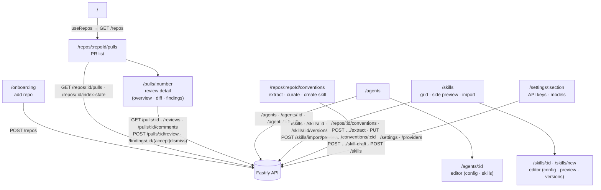

# `@devdigest/web` — the studio (Next.js 15)

The DevDigest UI: import repos, browse pull requests, run and read AI reviews,
and author agents. App Router + React Server/Client components, data via
**TanStack Query** hooks over the Fastify API. (This is the starter surface;
later milestones add the Skills, Memory, Eval, Blast/Brief, multi-agent, CI, and
dashboard screens.)

- **Stack:** Next.js 15 (App Router), React 19, TanStack Query, `next-intl`
  (messages in `messages/<locale>/*.json`), `recharts`, `mermaid`,
  `react-markdown`. UI primitives are vendored under `src/vendor/ui`
  (`@devdigest/ui`) and shared Zod contracts under `src/vendor/shared`
  (`@devdigest/shared`).
- **API base:** `NEXT_PUBLIC_API_BASE` (default `http://localhost:3001`), used by
  `src/lib/api.ts`. Every data hook lives in `src/lib/hooks/*`.
- **Run:** `pnpm dev` (`:3000`). **Test:** `pnpm test` (vitest + jsdom, fetch
  mocked — no API needed). **Typecheck:** `pnpm typecheck`.

## UI route map

Routes (`src/app/**/page.tsx`) and the API surface each leans on (via
`src/lib/hooks/*` → `src/lib/api.ts`):

Cross-cutting chrome lives in `src/components/app-shell` (nav, breadcrumbs,
`g`-then-key shortcuts). Pages are thin Server Components that render one client
`_components/<Name>View`; feature logic sits in colocated `_components/<Name>/`
folders, each with its own `*.test.tsx`. Root `error.tsx`, `global-error.tsx` and
`not-found.tsx` catch unexpected failures and unknown URLs. The layering rules
(no `'use client'` on routes, no inline query keys, no `app/` imports from shared
code, …) are enforced by `src/test/architecture.test.ts`.

**Skills (M2).** Skill rules shared by `/skills` and the agent Skills tab (slug check,
link ordering, "reaches the prompt" = link AND skill enabled) live in `src/lib/skills.ts`;
hooks in `src/lib/hooks/skills.ts` (incl. `useAgentSkills` / `useSetAgentSkills`, optimistic);
the type chip is `src/components/skill-type-badge`. Skill bodies render through the
`Markdown` primitive inside a `.skill-md` wrapper (`app/globals.css`), which restores
heading/list styles Tailwind's preflight strips. Runtime imports from `@devdigest/shared`
work because `next.config.mjs` maps `.js` → `.ts` (`extensionAlias`).

**Conventions (M2).** `/repos/:repoId/conventions` (sidebar SKILLS LAB → Conventions, `g c`)
runs the extractor, lists candidates as `ConventionCard`s (accept / reject toggles, inline
rule edit, evidence linked to GitHub at the cited lines) and opens
`CreateConventionSkillModal`, which edits the server-built draft and saves it through
`useCreateSkill` (`type: convention`, `source: extracted`, disabled by default). Hooks:
`src/lib/hooks/conventions.ts` (optimistic status / rule). Pure rules:
`src/lib/conventions.ts`.

**Form controls.** `app/globals.css` sets `color-scheme` per theme (so an open `<select>`
list is drawn dark in the dark theme) and adds an accent border on focus for the kit's
`TextInput` / `SelectInput` / `Textarea`, whose inline styles set `outline: none`. The
vendored kit is untouched; extend these rules there rather than per screen.

## Testing

Component/interaction tests (`*.test.tsx`) run under vitest + jsdom with `fetch`
mocked, so they need neither the API nor a browser. The real browser journeys
(client + API + seeded DB) are covered by the deterministic agent-browser suite
in [`../e2e`](../e2e/README.md) and the `e2e-web.yml` workflow. See
[`../TESTING.md`](../TESTING.md).
