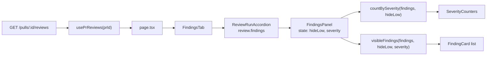

# Severity counters + filter in a review run
- **Status:** done (code) — PR + demo video pending
- **Milestone:** — (lab homework) · **Packages:** client
- **Owner:** Eduard Pershyn

## Problem

On the PR page → **Agent runs** tab → **Review runs**, every run (`ReviewRunAccordion`)
expands into its own `FindingsPanel` with a list of `FindingCard`s. To learn how many
findings of each severity a run produced, the user has to scroll and count. The run header
only shows `N findings · M blockers`, where *blockers* = CRITICAL findings that are **not
dismissed** — a different number from what this feature needs.

We want, inside each expanded run, a row of counters — `1 CRITICAL · 3 WARNING · 1 SUGGESTION`
— that doubles as a single-select severity filter for that run's list.

## Scope / Non-goals

**In scope**
1. Severity counters in the `FindingsPanel` toolbar (left side, same row as
   *Hide low confidence*), one per contract severity.
2. Click a counter → the list shows only findings of that severity. Click it again → filter
   cleared. Click another → filter moves there. One active level at a time.
3. Severity filter combines with *Hide low confidence* (logical AND).
4. Active counter is highlighted with its `SEV` colour; the other two are muted (P3).
5. Unit + component tests; `pnpm test` and `pnpm typecheck` green in `client/`.

**Non-goals**
- Server, contract, DB or API changes. `GET /pulls/:id/reviews` (via `usePrReviews`) already
  returns every run with its `findings[]`.
- Changing the run header's `N findings · M blockers` text or `VerdictBanner`.
- Changing `FindingCard`.
- Editing `src/vendor/ui/**` (do-not-touch). No new colours: only `SEV` tokens.
- New severity levels. `INFO` exists in `SEV` and `SEVERITY_ORDER` but **not** in the Zod
  `Severity` contract — it gets no counter.
- Persisting the filter (URL, localStorage) or sharing it across runs. Each run's filter is
  local and resets when the accordion is collapsed (the panel unmounts).
- Multi-select, keyboard shortcuts for the filter, a separate "Clear" button.
- The findings hover-popovers in the Timeline and PR-list mockups (`image.png`,
  `image (1).png`) — separate feature.
- Fixing the pre-existing global `keydown` listener (every open panel reacts to `j/k/a/d`).

## Decisions

| Question | Decision |
|---|---|
| Which severities get a counter | `CRITICAL`, `WARNING`, `SUGGESTION` — exactly the Zod `Severity` contract. `SEVERITY_LEVELS` lists them by hand (see *Implementation notes*), guarded by a compile-time exhaustiveness type and a test against `Severity.options`. |
| What a counter counts | Findings of that run **after** the *Hide low confidence* filter, **before** the severity filter. Invariant: clicking `N WARNING` shows exactly `N` cards. With the toggle off (default) the counts are the run's raw totals. |
| Dismissed / accepted findings | Counted. They stay in the list today (`visibleFindings` does not drop them), so the counter must match. |
| Zero-count level | **Still rendered** (P1: "all three levels are visible"), muted and `disabled` so it can't filter to an empty list. Exception: the *active* counter stays enabled even if its count drops to 0 (e.g. *Hide low confidence* switched on afterwards), so the filter can always be cleared. ⚠ The reference screenshot `l01-hw-06-zero-level-hidden.png` hides zero levels instead — see Open questions. |
| Where the state lives | `useState<Severity \| null>(null)` in `FindingsPanel`, next to `hideLow`. One panel per run → independent per run. |
| Clear | Click the active counter again (toggle). |
| Visuals | Pill buttons built from `SEV[sev]`: border `SEV.c`, text `SEV.c`. Active: background `SEV.c`, text `var(--bg-surface)` (filled pill, as in screenshots 02/03). When a filter is active, inactive pills get `opacity: 0.45`. No hover-only styling. |
| `SeverityBadge` reuse | Not used for the counters: it renders `ICON LABEL count` (wrong order for `3 CRITICAL`) and isn't a button. Colours + labels still come from the same `SEV` object it uses. |
| `·` separator from the AC text | Rendered as separate pills with a gap (as in every reference screenshot); the accessible name of the group reads naturally without it. |
| Focused card (`j/k`) | `focusIdx` resets to `0` whenever the severity filter changes, so focus never points past the end of the new list. |

## Design

### Data flow (no new requests)



Everything is derived in memory from `findings` already passed to `FindingsPanel`. Clicking
a counter only calls `setSeverity` — no query invalidation, no mutation, no run.

### `FindingsPanel/constants.ts`

```ts
import type { Severity } from "@devdigest/shared";   // TYPE-only — see Implementation notes
export const SEVERITY_LEVELS = ["CRITICAL", "WARNING", "SUGGESTION"] as const satisfies readonly Severity[];
type AssertNever<T extends never> = T;
export type SeverityLevelsAreExhaustive = AssertNever<Exclude<Severity, (typeof SEVERITY_LEVELS)[number]>>;
```

### `FindingsPanel/helpers.ts`

```ts
/** Drop low-confidence findings when hideLow is on. */
export function applyConfidence(findings: FindingRecord[], hideLow: boolean): FindingRecord[];

/** Per-severity counts after the confidence filter. Every contract level present, 0 if none. */
export function countBySeverity(findings: FindingRecord[], hideLow: boolean): Record<Severity, number>;

/** Confidence filter → optional severity filter → sort by SEVERITY_ORDER. */
export function visibleFindings(
  findings: FindingRecord[],
  hideLow: boolean,
  severity: Severity | null = null,   // default keeps the existing call signature valid
): FindingRecord[];
```

`visibleFindings` and `countBySeverity` share `applyConfidence`, so the two can't drift.

### New component — `FindingsPanel/_components/SeverityCounters/`
(`SeverityCounters.tsx`, `index.ts`, `styles.ts`; tested through `FindingsPanel.test.tsx`)

```ts
function SeverityCounters(props: {
  counts: Record<Severity, number>;
  active: Severity | null;
  onToggle: (sev: Severity) => void;   // parent does: setSeverity(s => s === sev ? null : sev)
}): JSX.Element
```

- Wrapper: `<div role="group" aria-label={t("groupLabel")}>` (`useTranslations("prReview.panel.severityFilter")`).
- Per level in `SEVERITY_LEVELS`: `<button type="button" aria-pressed={active === sev}
  disabled={counts[sev] === 0 && active !== sev}>`, visible text
  `t("panel.severityFilter.counter", { count, label: SEV[sev].label })` → `3 Warning`,
  shown uppercase via `textTransform: "uppercase"` (same as `SeverityBadge`).
- `title` only (tooltip): `t("show", …)` when inactive, `t("clear", …)` when active. No
  `aria-label` on the buttons — the accessible name stays the visible text `3 Warning`
  (WCAG 2.5.3 label-in-name); state is conveyed by `aria-pressed`.
- Lives at `FindingsPanel/_components/SeverityCounters/` (`SeverityCounters.tsx`, `styles.ts`,
  `index.ts`); `pillStyle(sev, {active, muted, disabled})` reads only `SEV[sev].c`.

### `FindingsPanel/FindingsPanel.tsx`

```tsx
const [severity, setSeverity] = React.useState<Severity | null>(null);
const counts = React.useMemo(() => countBySeverity(findings, hideLow), [findings, hideLow]);
const shown  = React.useMemo(() => visibleFindings(findings, hideLow, severity), [findings, hideLow, severity]);
const toggleSeverity = React.useCallback((sev: Severity) => {
  setSeverity((cur) => (cur === sev ? null : sev));
  setFocusIdx(0);
}, []);
```

Toolbar: `<SeverityCounters …/>` first, then the existing `toggleGroup` (already
`marginLeft: auto`, so it stays right-aligned). The empty state (`No findings match` /
`Adjust the filters above…`) already covers "filter leaves nothing".

### `messages/en/prReview.json` → `panel`

```json
"severityFilter": {
  "groupLabel": "Filter findings by severity",
  "counter": "{count} {label}",
  "show": "Show only {label} findings ({count})",
  "clear": "Clear {label} filter"
}
```

### Untouched
`ReviewRunAccordion` (still passes `findings` as today), `FindingsTab`, `FindingCard`,
`page.tsx`, hooks, server, both `vendor/shared` copies.

## Acceptance criteria

**P1 — must**
- [x] An expanded run shows three counters `CRITICAL`, `WARNING`, `SUGGESTION`, each with a number.
- [x] Each number equals that run's findings of that severity (toggle off).
- [x] Clicking a counter shows only that severity's cards.
- [x] Clicking the active counter again restores the full list.
- [x] Two runs open at once keep independent filters.

**P2 — should**
- [x] Clicking a counter issues no `fetch` and starts no run (asserted in tests).
- [x] Severity filter + *Hide low confidence* together → only findings meeting both remain;
      counters show post-confidence counts.
- [x] Colours and labels come only from `SEV` (no new hex/CSS vars).
- [x] `cd client && pnpm test && pnpm typecheck` pass.

**P3 — nice**
- [x] Active counter filled with its `SEV.c`; the other two muted; state visible without hover
      (`aria-pressed="true"` on exactly one button).
- [x] Clicking another level moves highlight + filter; one active at a time.
- [x] Clicking the active level clears both; all three pills back to default look.

## Test plan (per `TESTING.md` — client suite, jsdom, fetch mocked)

| File | Covers |
|---|---|
| `FindingsPanel/helpers.test.ts` (new) | `countBySeverity`: all three keys present, zeros included; respects `hideLow` at the 0.65 boundary. `visibleFindings`: severity filter; severity + `hideLow` AND; `null` = old behaviour; sort order unchanged. |
| `FindingsPanel/FindingsPanel.test.tsx` (extend) | Fixture: 1 CRITICAL, 3 WARNING (one at conf 0.5), 1 SUGGESTION. Counters read `1 Critical` / `3 Warning` / `1 Suggestion` (match on text, case-insensitive). Click WARNING → 3 cards, `aria-pressed` true only on WARNING. Click SUGGESTION → filter moves. Click SUGGESTION again → 5 cards, no `aria-pressed="true"`. Toggle *Hide low confidence* with WARNING active → 2 cards and counter `2`. Zero-count level is `disabled`. `globalThis.fetch` spy not called. |

Keep the existing two smoke tests green (the empty-list case must render three `0` counters,
all disabled, plus the empty state). No e2e changes — no flow matches this toolbar.

## Implementation plan

1. `constants.ts` — `SEVERITY_LEVELS`.
2. `helpers.ts` — `applyConfidence`, `countBySeverity`, extend `visibleFindings`; write
   `helpers.test.ts` first (red → green).
3. `prReview.json` — `panel.severityFilter.*`.
4. `SeverityCounters` component + styles (from `SEV`).
5. Wire into `FindingsPanel` (state, memo, toggle, `focusIdx` reset).
6. Extend `FindingsPanel.test.tsx`; `pnpm test && pnpm typecheck`.
7. Manual check with `./scripts/dev.sh`: a run with all three levels; a run with no
   CRITICAL; two runs open at once; toggle combo; DevTools Network shows no request on click.
   Record the demo video here.
8. Wrap-up: flip this spec to `done`, update `client/specs/README.md`, run the
   `engineering-insights` skill (session note in `client/INSIGHTS.md`; note whether it
   triggered on its own or was invoked).

## Implementation notes (what changed vs. the plan)

- **`Severity.options` → hand-listed constant.** Importing `Severity` as a runtime value made
  the PR page return **500** in `next dev`: `Module not found: Can't resolve
  './contracts/findings.js'`. The shared barrel uses NodeNext-style `.js` specifiers, which
  Vitest/Vite resolve to `.ts` but Next's webpack (no `extensionAlias`) does not — so tests
  were green while the page was broken. Every other client file imports the barrel with
  `import type`. Fix: keep the import type-only; derive safety from a compile-time
  exhaustiveness type + `helpers.test.ts` asserting `SEVERITY_LEVELS` equals
  `Severity.options` (Vitest can import the value). Changing `next.config` was out of scope.
- **No `aria-label` on counters** (planned one) — label-in-name; `title` carries the hint.
- **Pre-existing, not fixed:** React logs *"Updating a style property during rerender
  (borderColor) when a conflicting property is set (borderLeftColor)"* whenever the focused
  `FindingCard` changes — reproduced with a bare `j` keypress on an untouched panel. The filter
  triggers it too (it resets focus to card 0). Fix belongs in `FindingCard/styles.ts`
  (use per-side `border{Top,Right,Bottom}Color`), outside this spec's scope.

## Verification

- `cd client && pnpm test` → 14 files / 63 tests pass (7 new in `helpers.test.ts`, 5 new in
  `FindingsPanel.test.tsx`). `pnpm typecheck` → clean.
- Real app (`next dev` + seeded DB), headless Chrome over CDP, PR `hack0xield/trading#1`,
  run *General Reviewer* (2 CRITICAL / 3 WARNING / 0 SUGGESTION, one WARNING at 60% conf):
  default 5 cards → CRITICAL 2 → WARNING 3 (highlight moves) → + Hide low confidence:
  counter `2 Warning`, 2 cards → click WARNING again: cleared, 4 cards (toggle still on).
  A second open run (0 findings) kept its own three disabled `0` counters throughout.
  Zero requests to the API (`:3001`) during all clicks.

## Delivery (non-code P1/P2 items)

PR from the fork, description containing:
- Implementation summary + demo video.
- The five phases: what this spec planned, what got cut or changed during implementation
  (update *Decisions* if so), how it was verified (test output, manual checks).
- Reviewer-runs report: baseline agent findings vs. Claude Code, and the effect of the
  prompt change.
- Whether `engineering-insights` fired automatically or manually.
- Repo still contains the lab's `CLAUDE.md` / `INSIGHTS.md` files.

## Open questions

- ~~**Zero-count levels: show disabled, or hide?**~~ **Resolved (2026-11-20): show, muted +
  disabled** (follows the P1 AC over screenshot `l01-hw-06`). Hiding would be a one-line
  `filter` in `SeverityCounters` plus one test change.
- ~~**Should counters ignore *Hide low confidence*?**~~ **Resolved (2026-11-20): they follow
  it**, so a counter always predicts the list length.
- **Runtime imports of `@devdigest/shared` in the client.** Add `webpack.resolve.extensionAlias
  {'.js': ['.ts','.tsx','.js']}` to `next.config` so contract values (Zod enums) can be used
  at runtime, or keep the type-only rule? Not decided here.
