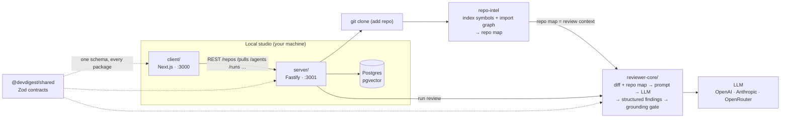

# Architecture

System-level view of DevDigest: how the four packages fit together and how a
review flows end to end. The root README links here.

The review flow end to end: **add a repo** → server clones it and `repo-intel`
indexes it (the **Indexed** badge) → **import PRs** from GitHub → open a PR and
**Review** → `reviewer-core` assembles a prompt from the diff + the repo map,
calls the LLM, validates every finding against the diff (the **grounding gate**
drops hallucinated line references), and persists structured findings with a
severity and score. All local; the only outbound calls are to GitHub (PR data)
and the LLM (via OpenRouter).
Since M3, the server first derives the PR's intent with one cheap model call (title,
body, linked same-repo GitHub docs, changed paths + hunk headers) and passes it to
`reviewer-core`, which adds a `## PR intent (derived)` prompt section and hides or
collapses out-of-scope findings after grounding (`../specs/M3-intent-layer.md`).

Each package has its own README with deeper diagrams:
[`client`](../client/README.md) (UI route map) ·
[`server`](../server/README.md) (API map) ·
[`reviewer-core`](../reviewer-core/README.md) (review pipeline) ·
[`e2e`](../e2e/README.md).

