# `@devdigest/reviewer-core` — the review engine

Pure review logic: **diff → prompt → LLM → grounded findings**. No database,
GitHub, or filesystem; the only side effect is an LLM call through an **injected**
`LLMProvider`, which is what makes it mock-testable.

In the starter the **server** (`@devdigest/api`) is its only consumer — for local
reviews in the studio. (The CI runner that runs the same engine in GitHub Actions
is added back in the Export-to-CI milestone, M6.) The server wires it via a tsconfig
path alias (`@devdigest/reviewer-core` → `../reviewer-core/src`) and consumes the
TypeScript **source** directly (tsx in dev, vitest in tests). The package never
emits JS — its `build` is a type-check.

## Pipeline

```mermaid
flowchart LR
  IN["inputs<br/>diff · system prompt · repo map"] --> PROMPT["assemblePrompt()<br/>prompt.ts"]
  PROMPT --> WRAP["wrapUntrusted() + INJECTION_GUARD<br/>fence untrusted content vs prompt injection"]
  WRAP --> LLM["LLMProvider (injected)<br/>llm/openrouter.ts"]
  LLM --> STRUCT["structured output<br/>llm/structured.ts<br/>Zod → JSON Schema · parse-with-repair"]
  STRUCT --> GROUND["groundFindings()<br/>grounding.ts<br/>mechanical citation gate vs the diff"]
  GROUND --> SCOPE["applyIntentScope()<br/>review/scope.ts<br/>only when an intent is present"]
  SCOPE --> OUT["Review<br/>verdict · score · grounded findings"]
```

The grounding step is the mandatory gate: a finding that doesn't cite a real line
in the diff is dropped, so the engine can't hallucinate locations. The score is
recomputed deterministically from the **surviving** findings, not trusted from the
model. `review/run.ts` orchestrates the run (single-pass by default).

The engine also accepts optional prompt slots the **later milestones** start
feeding it — `skills` (M2), `memory` (M7), `specs` (M5), `callers` — plus a
`reduce()`/map-reduce path and a `toReview()` CI payload helper used from M6.
The server passes the diff, system prompt, repo map, callers and — since M2 — the
agent's enabled skills; the other slots are omitted, so `assemblePrompt` leaves those
sections out.

**Skills (M2).** `skills` takes `SkillBlockInput[]` (`{ id, name, version, type, source,
description, body }`; plain strings still work for older callers). `renderSkillBlock`
turns each into its own `<skill name type source version>` block (description first as
"Apply when: …"; `</skill>` in the text escaped; attributes reduced to `[a-z0-9_-]`).
`assembly.skills` is the whole section and `assembly.skill_blocks[]` one entry per block
whose `text` is exactly the substring the model saw; `tokens` is left 0 for the caller
to fill (the server uses tiktoken).

**Intent (M3).** `intent` takes an `IntentBlockInput` (`{ summary, in_scope, out_of_scope,
confidence, missing_context: string[] }`, derived by the server). `assemblePrompt` renders
it right after `## PR description` as `## PR intent (derived)`: a trusted instruction to
set `in_scope` on every finding (scope never changes severity, the intent cannot waive
findings), then `renderIntentText(intent)` inside `<untrusted source="pr-intent">`.
Undefined or an empty summary → no section and no `assembly.intent_block`, so the prompt
is byte-identical to the pre-M3 one. `assembly.intent_block` leaves `tokens`, `model` and
`sources_used` for the caller to fill.

**Scope filter (M3).** With an intent present, `reviewPullRequest` runs
`applyIntentScope()` (`review/scope.ts`, pure) after `groundFindings`: a model-emitted
`scope_notice` is reset to `finding`; `in_scope !== false` → kept; out-of-scope WARNING /
SUGGESTION → `hidden` (returned in `outcome.scope.hidden`, not in the review); all
out-of-scope CRITICAL → ONE `scope_notice` CRITICAL finding citing the highest-confidence
one and listing every collapsed finding. The score is recomputed from the final set.
`outcome.scope` is `null` without an intent.

**Untrusted blocks.** `wrapUntrusted` neutralises case / whitespace variants of
`</untrusted>` and forged `<untrusted` openers, and reduces the `source` label to
`[a-z0-9:_./#-]` (max 80 chars).

## Public API

Exported from `src/index.ts`: `assemblePrompt` / `wrapUntrusted` / `renderSkillBlock` /
`renderIntentText` (prompt), `applyIntentScope` / `SCOPE_COLLAPSE_SEVERITY` (M3 scope filter),
`groundFindings` / `groundingSummary` (grounding), `toJsonSchema` / `extractJson`
/ `parseWithRepair` (structured output), plus the `run` entrypoint and
`reduce`. Contracts (`Review`, `Finding`, `Verdict`, …) come from
`@devdigest/shared`.

## Testing

`npm test` (vitest) — hermetic units with a stubbed `LLMProvider`: prompt
assembly, the grounding gate, `toReview` selection, and a full `run`. No keys,
no network. `npm run typecheck` doubles as the build. See
[`../TESTING.md`](../TESTING.md).
