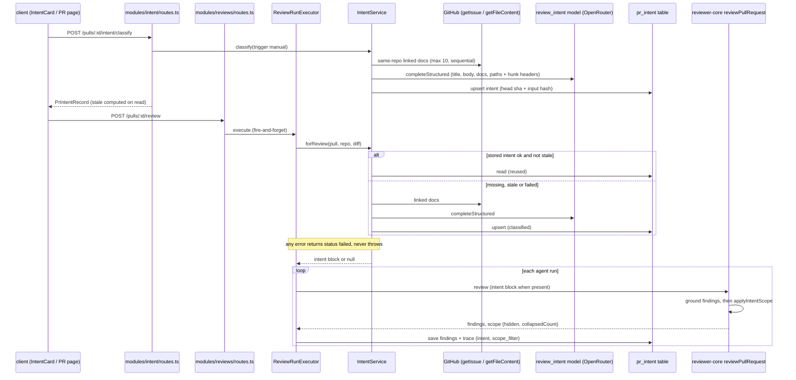

# Intent layer: classify + review flow

How a PR's intent is derived and then used by a review (M3). This page explains the flow;
routes, caps, link policy, `missing_context` reasons, logging fields and defaults are in
[`../README.md`](../README.md#intent-layer-m3), and the prompt/scope mechanics in
[`../../reviewer-core/README.md`](../../reviewer-core/README.md).

One `IntentService` instance (`Container.intentService`) serves both the intent routes
(`modules/intent/routes.ts`) and the review pre-work (through the reviews module's
`IntentProvider` port). Concurrent classifications of one PR share one in-flight promise.

Rendering of the diagram was not checked locally.

## Design notes

- **Failure never blocks a review.** `forReview` converts every error into
  `{ status: 'failed', reason }`; each agent then runs with no intent, so the prompt and
  findings equal the pre-M3 ones. The manual route surfaces the same failure as a 502.
- **Scope never waives a critical defect.** Out-of-scope CRITICAL findings are collapsed
  into one `scope_notice` instead of being hidden, because the intent is derived from
  untrusted author text.
- **Known gap.** Staleness covers the PR's own head sha, title, body and base only. Edits to
  linked issues or docs after classification are not detected.
- **Not yet exercised.** The e2e flow `e2e/specs/10-intent.flow.json` exists but has not
  been run.
