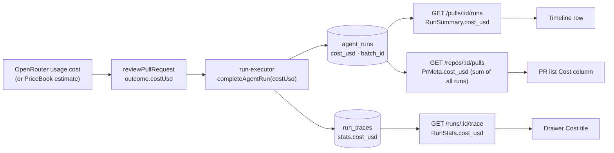

# Run cost badge
- **Status:** done
- **Milestone:** M1 · **Packages:** server, client (reviewer-core: none — read-only dependency)
- **Owner:** Eduard Pershyn
- **Revised:** 2026-11-20 — the PR-list Cost column now totals **all** review runs of the PR
  (lifetime spend) instead of the latest review batch.

## Problem

Every review spends real money on LLM calls, but the studio never shows it. The engine
already computes the cost of each run — `OpenRouterProvider.completeStructured` asks
OpenRouter for `usage.cost` and falls back to the injected `PriceBook` estimate
(`reviewer-core/src/llm/openrouter.ts`); `reviewPullRequest` sums it across map chunks into
`outcome.costUsd` (`reviewer-core/src/review/run.ts:184`). The server then **drops it**:
`run-executor.ts` persists `tokensIn`/`tokensOut` but not `costUsd`, `agent_runs` has no
cost column, and no contract carries it to the client.

We want cost visible on three screens, with **zero additional model calls**.

## Scope / Non-goals

**In scope**
1. **PR list** (`/repos/:repoId/pulls`) — a `Cost` column: total cost of **all review runs**
   of the PR (compact: `$0.012`).
2. **Agent runs tab → Timeline** — each run row shows its cost next to the launch time
   (`ran_at`), full variant: `$0.014 · 15k→1.2k`.
3. **Run trace drawer** (Agent run · <agent>) — a `Cost` stat tile beside Duration, Tokens,
   Findings.

**Non-goals**
- Capturing partial spend of **failed / cancelled** runs. They keep recording 0 tokens and
  show `—`. (Needs reviewer-core to expose usage on throw — see Open questions.)
- Backfilling cost for runs that predate this change. They show `—`.
- The FINDINGS column and per-row "Run Review" button in the PR-list mockup — separate work.
- Cost in the REVIEW RUNS accordion / VerdictBanner, multi-agent columns, agent stats,
  budgets or alerts.
- Changing how cost is computed (OpenRouter `usage.cost` → PriceBook → static table stays).

## Decisions

| Question | Decision |
|---|---|
| Where per-run cost sits on the Agent runs tab | Timeline row, under the `ran_at` time |
| What the PR-list total sums | **All runs of the PR** (lifetime spend); `null` only when no run has cost data |
| Failed / cancelled runs | `cost_usd = null` → `—` |
| Legacy runs (no cost stored) | `—`, no backfill |
| Known cost of exactly 0 (free model) | `$0.00` — `—` is reserved for "no data" |

## Design

### Data flow

### DB — `server/src/db/schema/runs.ts` + new migration `0010_*`

Add to `agent_runs`:

| Column | Type | Notes |
|---|---|---|
| `cost_usd` | `double precision` NULL | USD for the run; null = unknown (failed, cancelled, legacy, unpriced model). Matches `eval.ts` / `ci.ts` `costUsd`. |
| `batch_id` | `uuid` NULL | Shared by every run created by one `runReview` call. Null on legacy rows. Groups one click's runs; not used by the PR-list total. |

Index: `agent_runs (pr_id, batch_id)` — its `pr_id` prefix serves the PR-list aggregate.
Generate with `pnpm db:generate`; never edit existing migrations.

### Contracts — update BOTH `server/src/vendor/shared` and `client/src/vendor/shared`

- `contracts/trace.ts` → `RunSummary`: `cost_usd: z.number().nullable()`.
- `contracts/trace.ts` → `RunStats`: `cost_usd: z.number().nullish()` (**nullish**, so traces
  stored before this change still parse).
- `contracts/platform.ts` → `PrMeta`: `cost_usd: z.number().nullish()` — list endpoint only,
  same pattern as `score`. `PrDetail` extends `PrMeta`; `/pulls/:id` may omit it.

### Server

1. **`reviews/service.ts` `runReview`** — `const batchId = randomUUID()` once per call; pass
   it to every `createAgentRun`.
2. **`reviews/repository/run.repo.ts`**
   - `createAgentRun(values)` accepts `batchId: string | null`.
   - `completeAgentRun(values)` accepts `costUsd?: number | null` (default null).
   - `listRunsForPull` maps `cost_usd: run.costUsd`.
   - (`repository.ts` re-exports / wraps these — keep both signatures in sync.)
3. **`reviews/run-executor.ts`**
   - Success path: destructure `costUsd` from `outcome`; pass to `completeAgentRun` and set
     `trace.stats.cost_usd = costUsd`.
   - `failAll`, catch path, `traceFromBuffer`: `costUsd: null` / `stats.cost_usd: null`.
4. **`pulls/routes.ts` `GET /repos/:id/pulls`** — next to the latest-score query, one grouped
   query over `agent_runs`:
   `SELECT pr_id, sum(cost_usd) … WHERE workspace_id = ? AND pr_id IN (…) GROUP BY pr_id`.
   SQL `sum` ignores NULLs and returns NULL when every value is NULL, which is exactly the
   null rule below. Workspace-scoped like the rest of the handler.
5. **`server/README.md`** — note `cost_usd` on the runs/pulls responses.

Aggregation rules (PR-list total = lifetime spend on the PR):
- Sum of non-null `cost_usd` over **every** run of the PR, across all "Run review" clicks.
- `null` → `—` when the PR has no runs, or none of its runs has cost data (only failed,
  cancelled or pre-M1 runs).
- Failed / cancelled / legacy runs add nothing; a later failed run does **not** blank the total.
- Run still in progress → contributes once it finishes (the list does not live-update; it
  catches up on the next refetch).
- Deleting runs from the timeline → the total recomputes on read and drops by their cost.

### Client

**Shared formatting + component** — `client/src/components/run-cost-badge/`
(`RunCostBadge.tsx`, `helpers.ts`, `index.ts`, `RunCostBadge.test.tsx`):

`formatCost(usd: number | null | undefined): string`

| Input | Output |
|---|---|
| `null` / `undefined` / `NaN` | `—` |
| `0` | `$0.00` |
| `0 < x < 0.001` | `<$0.001` |
| `0.001 ≤ x < 1` | 3 decimals — `$0.014` |
| `x ≥ 1` | 2 decimals — `$1.27` |

`<RunCostBadge costUsd tokensIn? tokensOut? variant="compact" | "full" />`
- `compact` → `$0.012` (mono, muted). Used by the PR list.
- `full` → `$0.014 · 15k→1.2k`; reuses `formatTokens` (move it from
  `RunTraceDrawer/helpers.ts` into the badge's `helpers.ts` and re-import it in the drawer).
  When cost is null it renders `—` only, with no tokens.
- `title` tooltip: "Cost of this run (OpenRouter-reported or estimated)" / "No cost data".
- Strings in `messages/en/runs.json` (`cost.tooltip`, `cost.noData`).

**1. PR list** — `app/repos/[repoId]/pulls/`
- `constants.ts`: insert `"cost"` into `COLUMN_KEYS` after `"status"`; widen `GRID` to
  `1fr 132px 92px 60px 118px 76px 78px`.
- `PRRow.tsx`: new cell
  `<RunCostBadge variant="compact" costUsd={pr.cost_usd} tooltip={t("list.costTooltip")} />`.
  `RunCostBadge` takes an optional `tooltip` that replaces the per-run tooltip when cost is known.
- `messages/en/prReview.json`: `list.columns.cost = "Cost"`;
  `list.costTooltip = "Total cost of all review runs on this PR (OpenRouter-reported or estimated)"`.

**2. Timeline** — `pulls/[number]/_components/RunHistory/RunHistory.tsx`
- In the right-aligned column (already `flexDirection: column`), under the `ran_at` time:
  `<RunCostBadge variant="full" costUsd={r.cost_usd} tokensIn={r.tokens_in} tokensOut={r.tokens_out} />`
  for `status === "done"`; `—` for failed/cancelled; nothing while `running`.

**3. Run trace drawer** — `RunTraceDrawer/_components/TraceBody/TraceBody.tsx`
- Fourth `<Stat label={t("trace.stat.cost")} val={formatCost(stats.cost_usd)} />` between
  Tokens and Findings (matches the mockup order).
- `messages/en/runs.json`: `trace.stat.cost = "COST"`.
- `statsRow` is `display:flex` — four tiles fit the 720px drawer; no style change expected.

## Acceptance criteria

- [ ] A completed run with priced usage stores `agent_runs.cost_usd` equal to `outcome.costUsd`
      and `run_traces.trace.stats.cost_usd` with the same value.
- [ ] Failed, cancelled and pre-work-failed runs store `cost_usd = null`.
- [ ] All runs from one `POST /pulls/:id/review` share one `batch_id`; separate calls get
      different ones.
- [ ] `GET /pulls/:id/runs` returns `cost_usd` on every row.
- [ ] `GET /repos/:id/pulls` returns `cost_usd` = sum over **all** runs of the PR; `null`
      for never-reviewed PRs and for PRs whose runs have no cost data.
- [ ] Old traces (no `stats.cost_usd`) still load in the drawer and show `—`.
- [ ] PR list shows a `Cost` column after Status; `—` for unreviewed / no-data PRs.
- [ ] Timeline: every `done` run shows `$x · in→out` beside its time; failed/cancelled show `—`.
- [ ] Drawer Stats shows Duration · Tokens · Cost · Findings.
- [ ] No new LLM / OpenRouter calls are introduced (cost comes only from the existing response
      usage + PriceBook).
- [ ] `cd server && pnpm typecheck` and `cd client && pnpm typecheck` pass; both contract
      copies updated.

## Test plan (per `TESTING.md` — one happy path + the edge that matters)

| Suite | File | Covers |
|---|---|---|
| server-integration | `server/test/reviews.it.test.ts` (extend) | MockLLMProvider returns `costUsd: 0.001` → after `waitForPrRuns`, `cost_usd` > 0 on the row, `trace.stats.cost_usd` set, shared `batch_id`; a failing agent → `cost_usd` null |
| server-integration | `server/test/reviews.it.test.ts` or new `pulls-cost.it.test.ts` | Unreviewed PR → null; two successful runs → `/repos/:id/pulls` returns their sum; a later failed run → sum unchanged |
| server-unit | `server/test/contracts.test.ts` | `RunStats` parses with and without `cost_usd` (legacy trace) |
| client | `RunCostBadge.test.tsx` | `formatCost` table above; full variant hides tokens when cost is null |
| client | `RunHistory.test.tsx` (extend) | done run shows cost; failed run shows `—` |
| client | `RunTraceDrawer.test.tsx` (extend) | COST tile renders, `—` on a legacy trace |

e2e: no change. The seed creates no runs, so the list shows `—`, and existing flows match on
text that this change leaves as is.

## Implementation plan

Ordered so each step typechecks on its own.

1. **Contracts** — add `cost_usd` to `RunSummary`, `RunStats` (nullish), `PrMeta` in
   `server/src/vendor/shared/contracts/{trace,platform}.ts`, then mirror the same edits into
   `client/src/vendor/shared/contracts/`. Run `diff` on the two files to confirm only the
   pre-existing comment differences remain.
2. **Schema + migration** — add `costUsd`, `batchId` + index to `agentRuns`;
   `cd server && pnpm db:generate && pnpm db:migrate`.
3. **Repository** — `createAgentRun(batchId)`, `completeAgentRun(costUsd)`, `listRunsForPull`
   mapping (+ `repository.ts` wrapper types).
4. **Service** — `runReview` generates the batch id.
5. **Executor** — persist `costUsd` on success; `null` on every failure path; `stats.cost_usd`
   in both trace builders.
6. **PR list aggregate** — all-runs cost (`GROUP BY pr_id`) in `pulls/routes.ts`.
7. **Server tests** — integration + contract cases above; `pnpm exec vitest run`.
8. **Client badge** — `components/run-cost-badge/` with `formatCost`, moved `formatTokens`,
   i18n keys, unit test.
9. **PR list column** — `COLUMN_KEYS`, `GRID`, `PRRow`, `prReview.json`.
10. **Timeline** — `RunHistory` right column.
11. **Drawer** — `TraceBody` Cost tile, `runs.json`.
12. **Client tests** — `pnpm test && pnpm typecheck`.
13. **Docs** — `server/README.md` response fields; flip this spec to `done`; add rows to
    `specs/README.md`; `engineering-insights` session note.

Manual check: `./scripts/dev.sh`, review a PR with an OpenRouter agent, confirm the three
surfaces; review again and confirm the list total **increases** by the new run's cost and
equals the sum of the timeline row costs.

## Open questions

- **Partial spend on failure.** Map-reduce can fail on chunk N after paying for N-1 chunks,
  and the schema-repair loop can pay for 3 attempts and then throw. Recording this needs
  `reviewPullRequest` / `OpenRouterProvider` to expose accumulated usage on throw (e.g. an
  `onUsage` callback in `ReviewInput`). Deferred; worth doing if the totals undercount badly.
- ~~**Latest batch vs total spend.**~~ **Resolved (2026-11-20): all-time total.** The column
  was read as "money spent on this PR", so it now sums every run instead of the latest batch.
- **Estimated vs reported cost.** We don't record whether `cost_usd` came from OpenRouter or
  from the price table. A `cost_source` column would allow an "≈" marker; not needed for M1.
