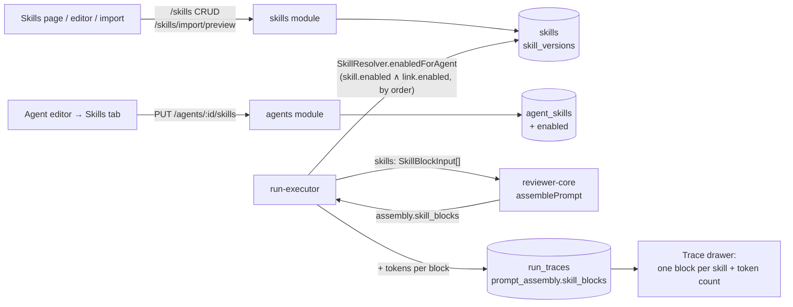

# Skills in the product
- **Status:** in-progress
- **Milestone:** M2 · **Packages:** server, client, reviewer-core, e2e (+ both `@devdigest/shared` copies)
- **Owner:** Eduard Pershyn

## Problem

An agent today is one monolithic `system_prompt`. Review knowledge that several agents
need (a test-quality rubric, an API-contract checklist, a house convention) must be
copy-pasted into each prompt and drifts. We want **skills**: named, versioned, text-only
blocks of review guidance that live in the workspace library and can be attached to any
number of agents, enabled/disabled per agent, and ordered.

Much of the groundwork exists but nothing connects it:

| Piece | State today |
|---|---|
| `skills`, `skill_versions`, `agent_skills` tables | exist since `0000_init.sql`; nothing writes `skills` |
| `Skill` / `AgentSkillLink` contracts | exist in `contracts/knowledge.ts` (both shared copies) |
| `GET/POST /agents/:id/skills` | exist (`server/src/modules/agents/routes.ts`), no per-agent `enabled` |
| Engine input `skills: string[]` | exists (`reviewer-core/src/review/run.ts`); joined into ONE `## Skills / rules` section (`reviewer-core/src/prompt.ts`) |
| Server → engine | **never passes skills** (`server/src/modules/reviews/run-executor.ts` `reviewPullRequest({...})`) |
| Trace `prompt_assembly.skills` | one string; trace drawer renders one "Skills" block |
| Skills UI | none; `client/messages/en/skills.json` holds unused strings, `/skills` not in the sidebar `NAV` |

## Scope / Non-goals

**In scope**
1. **Skill library** — `skills` server module with CRUD; the DB is the source of truth.
2. **Skills page** (`/skills`) — card grid (name, type, description, enabled toggle), side
   preview on click, **Add** button with *Create* / *Import*.
3. **Skill editor** (`/skills/new`, `/skills/:id`) — Name, Description (with directive-style
   helper text), Type, Markdown body; Config + Preview + Versions tabs (Versions = history
   with per-version diff and restore); Delete in the editor header.
4. **Agent ↔ skill association** — a **Skills** tab in the agent editor: attach, detach,
   enable/disable per agent, reorder. Order = order of skill blocks in the prompt.
5. **Import** — upload a `.md` file or a `.zip` archive → server extracts the core skill →
   preview → saved **only** after explicit confirmation. Nothing in an archive is executed.
6. **Prompt + trace** — each enabled skill becomes its own delimited block in the prompt and
   its own block (with token count) in the run trace's prompt assembly.
7. **Seeded agents + skills** — *Test Quality Reviewer* and *API Contract Reviewer* (see
   Decisions), with their skills.
8. **Controlled experiments** — fixtures + a reproducible procedure for the two
   with/without-skills comparisons and the trace check.

**Non-goals**
- Skill **Evals / Stats** tabs, "Run on evals", pull-frequency / accept-rate metrics, the
  "used by N agents" donut (mockups show them; later milestones).
- Import from URL and the community catalog (strings exist in `skills.json`; not built now).
- `.tar` / `.tar.gz` / `.7z` archives — `.zip` only.
- Conventions extractor (`source: 'extracted'`) — separate M2 feature.
- Selective/conditional skill loading (retrieval by description). Every enabled skill on an
  agent is always included.
- Wiring skills into the CI agent-runner (`AgentManifest.skills` slugs). Studio only.

## Decisions

| Question | Decision |
|---|---|
| What is a skill? | **Text only**: `name`, `description`, `type`, Markdown `body`. No tools, scripts, hooks, model, provider or any executable field — the contract has no place to put them and the create/update bodies are `.strict()`. |
| When is a skill in an agent's prompt? | `skills.enabled` (global, the card toggle) **AND** `agent_skills.enabled` (per agent, Skills tab). Disabled either way → absent from the prompt and the trace. |
| Where does the description go? | Into the skill's prompt block as the first line (`Apply when: …`). It is the skill's interface, so the editor asks for directive style. |
| Prompt position | Unchanged: the `## Skills / rules` section of the user message, after the PR description, before memory/repo map/diff. Each skill is a separate `<skill>` block, in link order. |
| Trust level of skill text | Skills are **instructions** (not `<untrusted>` data) — that is the point of a skill. Imported skills are therefore third-party instructions; the mitigation is an explicit confirmation step, imported skills saved **disabled** by default, and a persistent "imported" badge. |
| Archive formats | `.md` / `.markdown` and `.zip`. Parsed in memory with `fflate` (pure JS, no natives); nothing is written to disk. |
| Upload transport | JSON `{ filename, content_base64 }` with a route-level `bodyLimit` — no `@fastify/multipart` dependency. |
| Second agent | **API Contract Reviewer** is the second new agent (confirmed 2026-11-24). The checklist says "both new agents", and General Reviewer's base prompt already covers contract breaks ("Breaking a contract callers rely on"), so it can't show a without/with-skills difference. |
| Mockup tabs (Evals, Stats, Versions) | Owner's call: add what is cheap. **Versions** (history + restore) is in — the backend snapshots exist anyway. **Evals** and **Stats** are out — there is no eval or acceptance data per skill yet. |
| Does changing an agent's skill set bump the agent version? | **Yes.** Attach/detach/reorder/enable is a config change; the trace's `config.version` then tells "with skills" and "without skills" runs apart. |
| Skill name | Workspace-unique kebab-case slug (`^[a-z0-9]+(-[a-z0-9]+)*$`, ≤ 64 chars). Used as the block's `name=` attribute. |

## Design

### Data flow



### DB — migration `0011_skills.sql` (generated with drizzle-kit)

- `agent_skills.enabled boolean NOT NULL DEFAULT true`.
- `skills`: unique index `skills_workspace_name_uq (workspace_id, name)`; add
  `updated_at timestamptz NOT NULL DEFAULT now()`.
- `skill_versions`: add `name text`, `description text`, `type text` (nullable; no rows exist
  yet) so a snapshot captures the whole text config, not only the body.
- `skills.source` is a Drizzle text enum (no PG enum), so adding `imported_file` is a
  TypeScript-only change in `server/src/db/schema/skills.ts`.

Versioning mirrors agents: insert writes v1; any change to `name`/`description`/`type`/`body`
bumps `version` and snapshots it; toggling `enabled` does not.

### Contracts (`contracts/knowledge.ts` + `contracts/trace.ts`, **both** shared copies)

```ts
SkillSource = z.enum(['manual', 'imported_file', 'imported_url', 'extracted', 'community']);
SkillName   = z.string().regex(/^[a-z0-9]+(-[a-z0-9]+)*$/).max(64);

Skill        // existing, + created_at, updated_at, agent_count (links, any state)
SkillInput   = z.object({ name: SkillName, description: z.string().min(1).max(500),
                          type: SkillType, body: z.string().min(1).max(50_000),
                          enabled: z.boolean().optional(),
                          source: z.enum(['manual', 'imported_file']).optional() }).strict();
SkillVersion = { skill_id, version, name?, description?, type?, body, created_at };

AgentSkillLink  // existing, + enabled: z.boolean()
AgentSkillLinksInput = z.object({ links: z.array(z.object({
                          skill_id: z.string().uuid(), enabled: z.boolean() })) }).strict();
Agent           // + skill_count: enabled links whose skill is enabled (card chip "3 skills")

SkillImportRequest = { filename: string, content_base64: string };
SkillImportPreview = {
  draft: { name, description, type, body },   // editable before saving
  source_filename: string,
  core_file: string,                          // e.g. "test-smells/SKILL.md"
  body_tokens: number,
  ignored: { path: string, reason: 'executable' | 'not-markdown' | 'extra-markdown'
             | 'unsafe-path' | 'too-large' }[],
  dropped_frontmatter: string[],              // e.g. ["allowed-tools", "hooks"]
  warnings: string[],                         // e.g. body links to scripts/check.sh
  name_conflict: boolean,
};

// trace.ts — PromptAssembly
skill_blocks: z.array(z.object({
  skill_id: z.string(), name: z.string(), version: z.number().int(),
  type: SkillType, source: SkillSource, text: z.string(), tokens: z.number().int(),
})).nullish(),      // `skills` (joined string) stays for old traces + back-compat
```

`AgentVersionConfig.skills` stays `string[]` (ordered ids of links that are enabled at
snapshot time) so old snapshots still parse; add `skill_links` (`{id, enabled, version}[]`,
nullish) for the full picture.

### Server — `server/src/modules/skills/` (onion layout, same shape as `agents/`)

`routes.ts` (delivery) → `service.ts` (application) → `ports.ts` → `repository.ts`
(Drizzle); pure `helpers.ts` (DTO mapping, `isSkillConfigChange`) and
`import/` (domain: `parseSkillMarkdown`, `selectCoreFile`; adapter: `zip-reader.ts` over
fflate). Registered in `server/src/modules/index.ts`.

| Route | Purpose |
|---|---|
| `GET /skills` | list (workspace-scoped), with `agent_count` |
| `GET /skills/:id` | one skill |
| `POST /skills` | create (`SkillInput`); 409 on duplicate name |
| `PUT /skills/:id` | update / toggle `enabled` (partial `SkillInput`); versions on config change |
| `DELETE /skills/:id` | delete; links cascade (agents lose the skill; their version bumps) |
| `GET /skills/:id/versions` | snapshots, newest first (Versions tab) |
| `POST /skills/import/preview` | **stateless**: parse upload → `SkillImportPreview`. Writes nothing. `bodyLimit` 2 MB |
| `PUT /agents/:id/skills` | replace the agent's ordered links (`AgentSkillLinksInput`); bumps agent version |

Existing `GET /agents/:id/skills` returns links with `enabled`; existing `POST` keeps working
(links it creates are `enabled: true`). Every skill id in a link payload must belong to the
caller's workspace (422 otherwise) — the link table has no `workspace_id`, so the service
checks it.

Saving an import is a normal `POST /skills` with `source: 'imported_file'` and the
(possibly user-edited) draft — the confirmation step *is* that second request.

#### Import pipeline (`POST /skills/import/preview`)

1. Decode base64; reject > 1 MB compressed.
2. By extension: `.md`/`.markdown` → step 4 with the file text. `.zip` → step 3. Anything
   else → 422 (`ValidationError`; this applies to every rejection below too).
3. **Zip, metadata first.** List entries from their headers without inflating.
   Reject > 200 entries or > 5 MB total declared uncompressed size (zip-bomb guard). Classify:
   - `unsafe-path`: absolute, `..` segments, backslashes, NUL, drive letters.
   - `executable`: anything under `scripts/`, `bin/`, `hooks/`, `tools/`, or with a code /
     binary extension (`sh py js ts rb exe dll so wasm jar …`, list in
     `skills/constants.ts`). *As built:* fflate does not expose unix mode bits or the
     symlink flag, so neither is checked. That is safe because nothing is ever written
     to disk: a symlink entry is just bytes, and a script is just text that is not read.
   - `__MACOSX/`, `._*`, `.DS_Store` and directory entries are skipped silently.
   - `not-markdown`: anything else that isn't `.md`.
   - Core file = first match of `SKILL.md` (case-insensitive) at root or one folder deep →
     the only `.md` → `README.md`. Others → `extra-markdown`. No candidate → 422 listing
     the entries.
   - **Only the core file is inflated** (fflate streaming `Unzip`; no other entry is ever
     `start()`ed). Its declared size must be ≤ 256 KB, and the stream is terminated once
     the output passes 256 KB, so a lying header can't inflate further. Every other entry
     is listed in `ignored` and its bytes are never decompressed.
4. **Markdown.** Strip a leading `---` YAML frontmatter block, parsed by a minimal flat
   `key: value` reader (no YAML lib, no anchors/tags). Keep `name`, `description`, `type`;
   every other key (`allowed-tools`, `tools`, `hooks`, `model`, `scripts`, …) goes to
   `dropped_frontmatter`. Fallbacks: name ← first `# H1` ← filename, slugified; description
   ← first paragraph; type ← `custom`.
5. Warnings: body references a file that was not imported (`scripts/…`, relative links),
   body > 8k tokens, name conflict. The body text is never modified except trimming —
   fenced code stays as inert Markdown text.

Nothing here spawns a process, evaluates code, writes to disk, or follows a link.

#### Review flow (`modules/reviews`)

- New port in `reviews/ports.ts`:
  `SkillResolver.enabledForAgent(workspaceId, agentId): Promise<ResolvedSkill[]>` — join
  `agent_skills` ⋈ `skills` where both `enabled`, `ORDER BY agent_skills.order`. Implemented
  by `SkillsRepository`, wired in the container (reviews never imports the skills module).
- New port `TokenCounter.count(text)`, wired to the existing `TiktokenTokenizer`.
- `run-executor.ts` `runOneAgent`: resolve skills, log
  `skills: 3 attached (branch-coverage-gaps, …)` (or `skills: none`), pass
  `skills: [{ id, name, version, type, source, description, body }]` to `reviewPullRequest`,
  then add `tokens` to each `outcome.assembly.skill_blocks[i]` before saving the trace.

### reviewer-core — `prompt.ts`

`PromptParts.skills` becomes `SkillBlockInput[]` (`{ id, name, version, type, source,
description, body }`); `ReviewInput.skills` likewise. Rendering:

```text
## Skills / rules
Apply each skill below when its "Apply when" line matches the change.

<skill name="branch-coverage-gaps" type="rubric" source="manual" version="2">
Apply when: Use when a PR changes source code with conditional logic …

# Branch coverage gaps
…body…
</skill>

<skill name="mocking-and-flakiness" type="convention" source="imported_file" version="1">
…
</skill>
```

- `</skill>` inside a body is escaped (same trick as `wrapUntrusted`), so a skill cannot
  close its own block or forge another.
- Attribute values are the validated slug / enums — no free text in attributes.
- `assembly.skills` = the whole section text (old consumers keep working);
  `assembly.skill_blocks` = one entry per block (`text` = exactly the rendered block);
  `tokens` is filled in by the server.
- Map-reduce: the same blocks go into every chunk's prompt; the trace records them once.
- No skills → section omitted (prompt byte-identical to today).

### Client

**Nav** — `vendor/ui/nav.ts`: a `SKILLS LAB` group with **Skills** (`/skills`, icon
`Sparkles`, `g s`) and **Agents**; add `g s` to `SHORTCUTS`.

**Data** — `lib/hooks/skills.ts`: `useSkills`, `useSkill`, `useCreateSkill`,
`useUpdateSkill`, `useDeleteSkill`, `useImportSkillPreview`; `lib/hooks/agents.ts`:
`useAgentSkills`, `useSetAgentSkills` (optimistic). Query keys invalidate `agents` too
(skill count chip).

**`/skills` — `app/skills/_components/SkillsListView`** (same structure as `AgentsListView`)
- Header: title, search, **Add Skill ▾** → *Create skill* (`/skills/new`) · *Import from
  file…* (opens `ImportSkillModal`).
- Grid of `SkillCard`: mono name, type badge (colour per type, as in the mockups), source
  label (Manual / Imported), 2-line description, enabled `Toggle` (stops propagation; calls
  `PUT /skills/:id {enabled}`). Disabled cards are dimmed. Empty state → Create / Import CTAs.
- Card click → `SkillPreviewDrawer` (kit `Drawer`): name, type, source, `vN`, enabled,
  description, body rendered with the existing `Markdown` primitive ("Rendered as the
  reviewing agent receives it"), "Attached to N agents", buttons **Edit** (`/skills/:id`) and
  **Delete** (confirm modal naming affected agents). Imported skills show the
  third-party-instructions notice.

**Editor — `app/skills/[id]/_components/SkillEditorView`** (`/skills/new` uses the same form)
- Left: skill list (like the agent editor). Tabs: **Config** · **Preview** · **Versions**
  (`?tab=`). Versions lists snapshots newest first (`vN`, date, first line of the body);
  **Restore** on an older one PUTs its name/description/type/body, which creates a new
  version (history is never rewritten).
- **Version diff** — each Versions row has a **Changes** toggle that expands an inline diff
  of that snapshot against the previous one (v1 against nothing). A *Compare* select picks
  any other snapshot as the base. The diff shows changed metadata (name / description /
  type, word-level highlights; fields an old snapshot did not record are skipped) and a
  unified line diff of the body (LCS, `+N −M` stats, unchanged runs folded to 3 lines of
  context, *Show all lines* expands). Pure helpers in `SkillVersionsTab/helpers.ts`; no
  server change — `GET /skills/:id/versions` already returns full snapshots.
- **Delete** — the editor header has a **Delete** button (same confirm as the drawer, naming
  the agents that lose the skill); after deleting it returns to `/skills`. The drawer and
  the editor share `_components/DeleteSkillButton`.
- Config: Enabled toggle, **Name*** (slug; inline validation), **Description*** with helper
  text under it:
  > *This is the skill's interface — the reviewer reads it to decide when the skill applies.
  > Write it as a directive: "Use when … Flag … Do not …".*
  — **Type** select, **Skill body*** (mono `Textarea`, filename header `<name>.md`, unsaved
  marker, live `~N tokens` estimate (chars/4)). Save → toast "Saved (vN)".
- Preview: the body via `Markdown`, plus the exact `<skill …>` block text it will add.

**Import — `ImportSkillModal`** (two steps; also reachable from the editor's Add menu)
1. *Choose file* — accepts `.md,.markdown,.zip`. A notice up front: *"Importing a skill adds
   someone else's instructions to your agents' prompts. Only import skills you have read."*
2. *Review* — editable draft (name/description/type), rendered body + raw toggle, token
   count, core file name, **"Not imported — never executed"** list (`ignored` + reasons),
   dropped frontmatter keys, warnings, name-conflict error. A required checkbox *"I've read
   this skill and accept its instructions into my agents' prompts"* gates **Save skill**.
   Saved disabled unless the user flips "Enable now". Cancel discards — nothing was stored.

**Agent editor — Skills tab** (`app/agents/[id]/_components/AgentEditor/_components/SkillsTab`)
- Add `{ key: "skills", … }` to `TABS` and `VALID_TABS`; `AgentEditor` switches body by tab.
- Header: "Skills" + badge `N of M enabled` (M = linked), filter box, **Attach skill ▾**
  (unlinked library skills). Hint: *"Order matters — earlier skills appear earlier in the
  assembled prompt. Drag to reorder."*
- Row: drag handle (native HTML5 DnD) + ↑/↓ buttons (keyboard), enable checkbox, mono name,
  type badge, "skill disabled globally" chip when `skill.enabled = false`, remove ×.
- Each change sends the full ordered list via `PUT /agents/:id/skills`.
- `AgentCard` shows `skill_count`.

**Trace drawer** — `TraceBody`: when `skill_blocks` is present, render a sub-header
*"Skills — 3 blocks · +1,240 tokens"* and one `PromptBlock` per skill
(label `Skill · <name> · v<N>`, new optional `meta` prop showing `+412 tok`). Otherwise fall
back to today's single Skills block. i18n in `runs.json`.

All new strings go to `client/messages/en/skills.json` / `agents.json` / `runs.json`
(rewrite the unused URL/community strings out of `skills.json`).

### Seed (`server/src/db/seed.ts`, idempotent by name)

Prompts live in `seed-prompts.ts` and are mirrored in `docs/agent-prompts/*.md` (per that
README). Base prompts set the role and output rules but deliberately leave the detailed
checklists to skills, so the experiments measure the skills' effect.

| Agent | Skills (order) | Origin |
|---|---|---|
| **Test Quality Reviewer** — reviews the tests in a PR: uncovered branches, missing corner cases, excessive mocking, flaky tests | 1. `branch-coverage-gaps` (rubric) · 2. `boundary-and-corner-cases` (rubric) · 3. `mocking-and-flakiness` (convention) | 1–2 seeded `manual`; **3 is imported** during the demo from `docs/skills-samples/test-smells-skill.zip` |
| **API Contract Reviewer** — flags breaking changes to HTTP routes and shared contracts | 1. `breaking-change` · 2. `response-schema` · 3. `semver-discipline` (rubrics) · 4. `deprecation-policy` (convention) | 1–3 seeded `manual`; **4 is imported** from `docs/skills-samples/deprecation-policy.md`. *Changed 2026-11-25; was `api-contract-breaking-changes` + `shared-contract-sync`* |

`docs/skills-samples/test-smells-skill.zip` (plus its unpacked source for review) holds
`test-smells/SKILL.md` with frontmatter (`name`, `description`, `allowed-tools: Bash`),
`scripts/detect-flaky.sh`, `scripts/count_mocks.py`, `README.md`. The import must show the
two scripts as *executable — not imported*, `allowed-tools` as dropped, and a warning that
the body references `scripts/detect-flaky.sh`.

### Controlled experiments

Fixtures in `specs/M2-skills/experiments/` (patches + `README.md` with exact steps). They are
applied as PRs on a sandbox GitHub repo the studio imports. Each run is done twice on the
same PR, same model: skills **off** (all links unticked in the Skills tab) and **on**.
Results (findings, agent version, tokens, cost) are written into the README as observed —
including if the "off" run happens to catch the issue.

1. **Test quality** — `src/pricing/discount.ts` adds `applyDiscount(price, code)` with an
   unknown-code throw, a percent > 100 clamp and a `price === 0` early return;
   `discount.test.ts` tests only one valid code. Expected *with* skills: findings on the
   uncovered error/clamp branches and the missing boundary cases (0, 100 %, negative price).
2. **API contract** — `GET /invoices/:id` becomes `GET /invoices/:invoiceId`, response
   field `amount` → `amount_cents`, and `?currency` becomes required; no version bump, no
   client change. Expected *with* skills: a breaking-change finding on the route and the
   response shape.
3. **Execution trace** — open the "on" run's trace → Prompt assembly: each skill is its own
   block with a `+N tok` count, and the Skills header shows the total. The "off" run has no
   Skills section. Untick one skill → re-run → that block is gone.

### Demo / video notes

Say explicitly when importing: *"Importing a third-party skill means putting someone else's
instructions into my agent's prompt. The import only extracts the Markdown text, shows me
what it dropped — scripts, tool permissions — and saves nothing until I confirm. It lands
disabled until I enable it."*

### Security summary (the "no tools, no code" guarantee)

| Threat | Control |
|---|---|
| Skill carries tools / code | Contract has no such fields; `.strict()` bodies reject unknown keys; frontmatter keys other than name/description/type are dropped and reported |
| Archive executes something | Only the core `.md` entry is ever inflated; no disk writes, no `child_process`, no `eval`, no dynamic `import()` in the import path (asserted by a unit test that stubs `child_process`/`fs.write*`) |
| Zip bomb / path traversal | entry-count, total-size and core-file-size caps checked on declared sizes before inflating; unsafe paths classified and skipped |
| HTML/script in body reaches the UI | the `Markdown` primitive does not enable raw HTML (no `rehype-raw`); covered by a client test |
| Skill breaks out of its prompt block | `</skill>` escaped; attributes are validated slugs/enums |
| Third-party instructions enter the prompt unnoticed | confirmation checkbox, saved disabled, "Imported" badge on card/drawer/trace (`source` attribute) |
| Cross-workspace skill linking | service checks every linked skill id belongs to the workspace |

### Tests (per `TESTING.md`)

- **reviewer-core unit** — `assemblePrompt`: blocks in given order, `</skill>` escaping,
  `skill_blocks[i].text` matches the prompt substring, section omitted when empty.
- **server unit** — import: `.md` with frontmatter; zip with `SKILL.md` + scripts (scripts
  listed `executable`, never inflated); `../` and absolute paths; entry/size caps; no
  Markdown → 422; `allowed-tools` dropped; name fallbacks. `isSkillConfigChange`.
- **server integration** — skills CRUD + 409 + workspace scoping; versions on config change
  only; `PUT /agents/:id/skills` order/enabled + version bump + foreign-skill 422; executor
  with a fake LLM passes only `skill.enabled ∧ link.enabled` skills, in order, and the saved
  trace has `skill_blocks` with tokens.
- **client** — `SkillCard` toggle doesn't open the drawer; editor shows the description
  helper text and validates the slug; `ImportSkillModal` Save disabled until the checkbox is
  ticked and lists ignored files; `SkillsTab` reorder/enable sends the right payload;
  `TraceBody` renders per-skill blocks and falls back for old traces; `Markdown` doesn't
  render `<script>`.
- **e2e** (deterministic, no LLM) — create → edit skill (version bumps); import the `.md`
  sample → preview → confirm → card appears disabled; attach to an agent and reorder.

### Docs on `done`

`server/README.md` (API map + "Skills (M2)" section), `client/README.md` (route map),
`docs/agent-prompts/README.md` (how skill blocks are assembled), `reviewer-core/README.md`
(prompt sections), new prompts in `docs/agent-prompts/`.

## As built (2026-11-24)

Deviations from the design above and decisions taken while implementing:

- `GET /skills/:id` also returns `prompt_block`, rendered on the server by reviewer-core's
  `renderSkillBlock`, so the editor's Preview shows the exact prompt text without a
  client copy of the renderer.
- The sidebar gained a **SKILLS LAB** group (Skills, Agents) with `g s`. This needed a
  data-only edit to `client/src/vendor/ui/nav.ts`: the vendored `Sidebar` reads `NAV`
  directly and has no override.
- The client imports runtime values (`SKILL_NAME_PATTERN`, limits) from
  `@devdigest/shared` for the first time; `client/next.config.mjs` now maps `.js` → `.ts`
  (`extensionAlias`) so webpack can resolve the barrel's NodeNext-style specifiers.
- Skill bodies render inside a `.skill-md` wrapper (`client/src/app/globals.css`) that
  restores heading/list/table styles stripped by Tailwind's preflight. Other Markdown
  surfaces are unchanged.
- Agent link counts on cards (`skill_count`) count only links that reach the prompt.
- `fflate` is fenced to `src/adapters/**` by adding it to `VENDOR_SDKS` in
  `server/.dependency-cruiser.cjs`.
- Follow-up from owner review (2026-11-24): the Versions **diff** (was a non-goal) and a
  **Delete** button in the editor header were added (see Client → Editor). Native form
  controls looked broken in the dark theme — an open `<select>` list was drawn in the
  browser's light theme with the dark theme's light text. `client/src/app/globals.css` now
  sets `color-scheme` per theme, styles `<option>`, and gives the kit's inputs an accent
  border on focus (the kit sets `outline: none` inline and draws no focus state). The
  vendored kit is unchanged; the rules apply to every input in the app.
- The e2e flow `e2e/specs/08-skills.flow.json` is written but was not run locally
  (`agent-browser` not installed here).

## Acceptance criteria

- [x] `pr-self-review` exists with `disable-model-invocation: true` (already true in
      `.claude/skills/pr-self-review/SKILL.md`).
- [ ] `/pr-self-review` run manually on this branch routes `client/` files to the frontend
      skills and `server/`/`reviewer-core/` files to `onion-architecture` (report shows both).
      *Manual only — the skill cannot be invoked by the model.*
- [x] A skill can be created and edited through the UI; an edit to name/description/type/body
      bumps its version, toggling `enabled` does not.
- [x] `/skills` shows the card grid (name, type, description, toggle); card click opens the
      side preview; **Add** offers Create and Import.
- [x] The description field shows the directive-style helper text.
- [x] The Versions tab shows what each version changed (metadata + body line diff) and can
      compare any two snapshots.
- [x] A skill can be deleted from the editor screen (list left, details right) as well as
      from the preview drawer; the confirm names the affected agents.
- [x] The agent editor has a Skills tab where skills can be attached, detached,
      enabled/disabled and reordered; the order is the order of blocks in the prompt.
- [ ] Test Quality Reviewer and API Contract Reviewer both have skills attached; at least one
      (`mocking-and-flakiness`) arrived via import.
      *Seed attaches 2 skills to each; the import of the third is the demo step
      (`specs/M2-skills/experiments/README.md` → Before you start, step 3).*
- [x] Import of `.md` and `.zip` shows a preview and saves nothing until confirmed; the zip's
      scripts are listed as not imported and are never decompressed or executed.
- [x] Enabled skills appear as separate blocks, each with a token count, in the run trace's
      prompt assembly.
      *Verified by `server/test/skills.it.test.ts` (mock LLM) and the drawer test; not yet
      seen in a real LLM run.*
- [x] A skill disabled globally or on the agent does not appear in the prompt or the trace.
- [x] No skill field, import path or prompt block can carry tools or executable code
      (security table controls are in place and tested).
- [ ] Both controlled experiments are reproducible from `specs/M2-skills/experiments/README.md`
      with the respective agents, and their observed results are recorded there.
      *Fixtures + procedure done; LLM runs and results pending.*
- [x] `pnpm typecheck`, `pnpm test`, `pnpm lint:arch` (server), client tests and
      reviewer-core tests pass; both shared copies carry the contract changes.

## Open questions

1. ~~Second agent~~ — resolved: API Contract Reviewer (see Decisions).
2. **Experiment outcomes are not guaranteed.** An LLM may catch the happy-path-only test
   without skills. We record what we observe; if the "off" run catches it, we tighten the
   fixture (subtler branch), not the base prompt.
3. **Token cost of always-on skills.** Every enabled skill is in every review (and every
   map-reduce chunk). Fine at 2–3 skills; a later milestone may select skills by description.
4. **Deleting a skill that agents use** silently changes those agents' prompts (their version
   bumps). The delete confirm names the agents; is a soft-delete/archive wanted instead?
